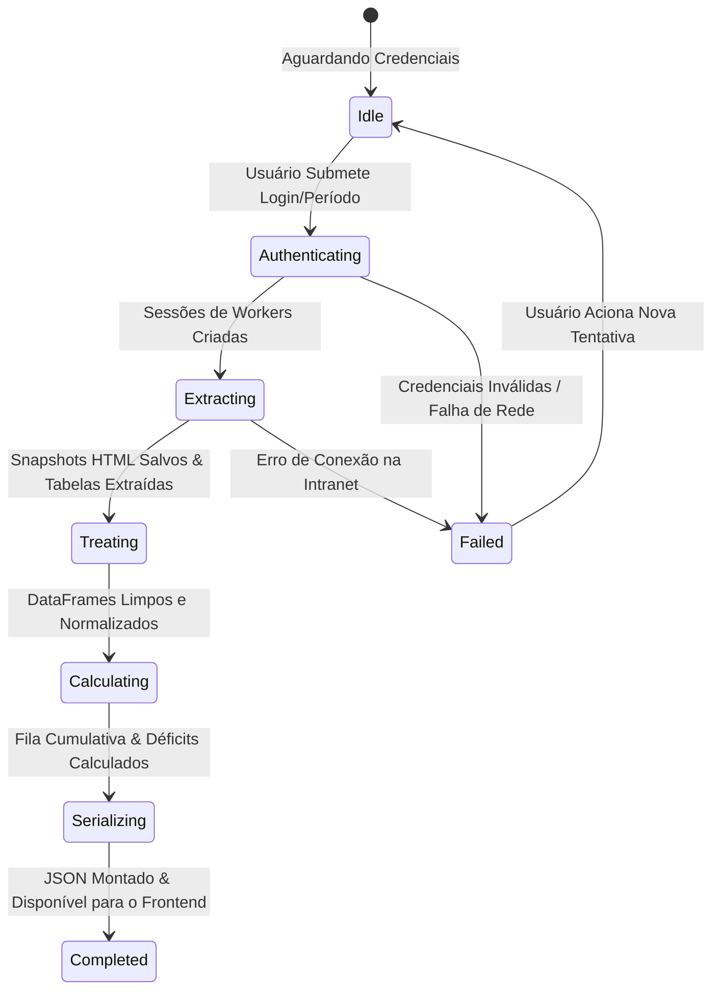

# Data Model: 001-frontend-ui-layout

**Feature**: Frontend UI & Análise de Erros de Apontamento (Líder Design Style)  
**Date**: 2026-10-19  
**Status**: Completed

## 1. Entity Definitions & Schemas

### 1.1 CredentialsPayload (In-Memory Auth)
Ingested by the login view and task generator; never stored to disk or logged.

| Field | Type | Required | Description |
|---|---|:---:|---|
| `username` | `string` | Yes | Intranet network username. |
| `password` | `string` | Yes | Intranet network password. |
| `data_inicio` | `string (YYYY-MM-DD)` | Yes | Start date for opening/delivery window filter. |
| `data_fim` | `string (YYYY-MM-DD)` | Yes | End date for opening/delivery window filter. |
| `fabricas` | `List[string]` | No | Optional factory filter (defaults to all factories if omitted). |

---

### 1.2 TaskDefinition (Extraction Task Skeleton)
Represents a scraping target configured in the task generator.

| Field | Type | Required | Description |
|---|---|:---:|---|
| `id` | `string` | Yes | Unique task identifier (e.g. `task_consumo_fabrica_01`). |
| `name` | `string` | Yes | Human-readable task name. |
| `group` | `string` | Yes | Functional group key (`consumo_ordem` or `estoque_local`). |
| `fabrica` | `string` | Yes | Associated factory code/name. |
| `url` | `string` | Yes | Intranet endpoint URL. |
| `method` | `string` | Yes | HTTP Method (`GET` or `POST`). |
| `payload` | `Dict[string, Any]` | No | Form-data, query parameters, or JSON body. |
| `headers` | `Dict[string, string]` | No | Additional HTTP request headers. |

---

### 1.3 OrdemProducao & ConsumoComponente (Raw Extracted Data)

#### OrdemProducao
| Field | Type | Description |
|---|---|---|
| `op` | `string` | Production order unique number. |
| `fabrica` | `string` | Factory identifier (e.g. `F01 - Móveis`). |
| `data_abertura` | `date` | Date when the OP was created/opened. |
| `data_entrega` | `date` | Scheduled delivery date for priority queuing. |
| `produto_codigo` | `string` | Finished product / assembly SKU. |
| `produto_descricao` | `string` | Finished product name. |
| `local_producao` | `string` | Production line / cell location where OP is executed. |
| `status` | `string` | Operational status of the OP. |

#### ConsumoComponente
| Field | Type | Description |
|---|---|---|
| `op` | `string` | Foreign key referencing `OrdemProducao.op`. |
| `codigo_componente` | `string` | Component / raw material item code. |
| `descricao_componente`| `string` | Component item description. |
| `baixa_automatica` | `boolean` | Flag indicating whether deduction is automatic (`True`) or manual (`False`). |
| `qtd_necessaria` | `float` | Required quantity for this order. |
| `unidade_medida` | `string` | Unit of measure (e.g., `UN`, `M2`, `KG`). |
| `local_producao` | `string` | Production location where the component must be available. |

---

### 1.4 RegistroSaldoEstoque (Raw Extracted Stock)

| Field | Type | Description |
|---|---|---|
| `codigo_item` | `string` | Item SKU / component code. |
| `local_estoque` | `string` | Warehouse, line-side rack, or production location code. |
| `saldo_disponivel` | `float` | Usable quantity available at the specified location. |
| `saldo_fisico` | `float` | Gross physical quantity on hand. |
| `saldo_reservado` | `float` | Quantity committed to other processes. |

---

### 1.5 ErroApontamentoSaldo (Calculated Divergence Record)

Output record resulting from the cumulative allocation engine.

| Field | Type | Description |
|---|---|---|
| `id` | `string` | Composite ID: `${fabrica}-${op}-${codigo_componente}`. |
| `fabrica` | `string` | Factory identifier. |
| `op` | `string` | Production order number. |
| `data_abertura` | `string (YYYY-MM-DD)` | OP opening date. |
| `data_entrega` | `string (YYYY-MM-DD)` | OP scheduled delivery date. |
| `prioridade_fila` | `integer` | Sequence rank in the cumulative consumption queue. |
| `produto_op` | `string` | Finished product description. |
| `local_producao` | `string` | Specific location required for consumption. |
| `codigo_componente` | `string` | Consumed item code. |
| `descricao_componente`| `string` | Consumed item description. |
| `baixa_automatica` | `boolean` | Always `True` for evaluated divergence records. |
| `qtd_necessaria` | `float` | Quantity needed by this OP. |
| `saldo_inicial_local`| `float` | Physical available balance at location prior to allocation. |
| `saldo_remanescente`| `float` | Remaining balance available when this OP's turn arrived. |
| `deficit_saldo` | `float` | Shortfall amount ($\text{qtd\_necessaria} - \max(0, \text{saldo\_remanescente})$). |
| `status_divergencia` | `enum` | `SALDO_INSUFICIENTE` \| `SALDO_ZERADO_NO_LOCAL` \| `ITEM_SEM_CADASTRO_ESTOQUE`. |
| `severidade` | `enum` | `ALTA` (déficit > 50% ou saldo zerado) \| `MEDIA` (déficit parcial). |

---

### 1.6 MetricsSummary (Dashboard KPIs)

| Field | Type | Description |
|---|---|---|
| `total_ops_analisadas` | `integer` | Count of unique OPs evaluated across all factories. |
| `total_componentes_baixa_auto` | `integer` | Count of components subject to automatic deduction. |
| `total_erros_apontamento` | `integer` | Total occurrences of pointing error deficits. |
| `total_ops_com_erro` | `integer` | Count of distinct OPs affected by at least one deficit. |
| `taxa_conformidade_pct` | `float` | Overall compliance percentage ($\frac{\text{total} - \text{erros}}{\text{total}} \times 100$). |
| `distribuicao_por_fabrica` | `Dict[str, Dict]` | Metrics sub-totals partitioned by factory. |
| `tempo_processamento_segundos`| `float` | Execution duration for the analysis run. |

---

## 2. Pipeline State Machine

