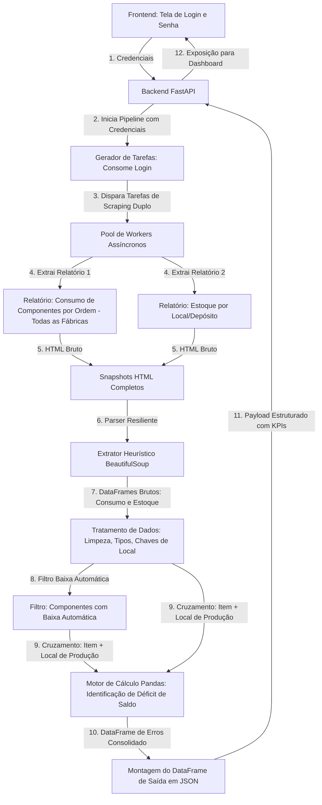

# Visão Geral: erros-apont

**Resumo:** Sistema de auditoria e análise de erros de apontamento de ordens de produção (OPs) em todas as fábricas. O pipeline extrai dois relatórios da intranet (**Consumo de Componentes por Ordem** e **Estoque**), filtra componentes com **baixa automática** e verifica se há saldo disponível suficiente no **local de produção** da ordem consumidora, consolidando os déficits em DataFrames Pandas e expondo-os via FastAPI na interface web sob o **Estilo Líder Design**.

## Arquitetura e Fluxo do Pipeline

## Índice de Módulos

- [[01-Frontend-UI/Interface_Login_e_Resultados]]
- [[02-Backend-API/Rotas_FastAPI_e_Sessao]]
- [[03-Dominio-Calculos/Motor_Calculo_Pandas]]
- [[04-Infra-Dados/Extrator_Workers_e_HTML]]
- [[05-Automacoes/Gerador_Tarefas_Scraping]]
- [[erros-apont-logbook/LOGBOOK_INDEX|Diário de Bordo]]
- [[../.specify/memory/constitution.md|Constituição do Projeto (v1.1.0)]]
- [[../specs/001-frontend-ui-layout/spec.md|Especificação Ativa: 001-frontend-ui-layout]]
